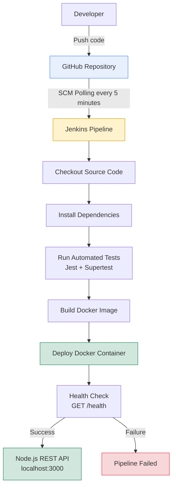
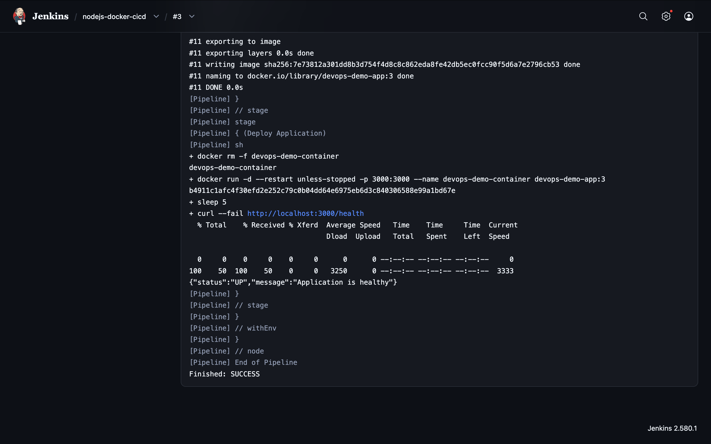
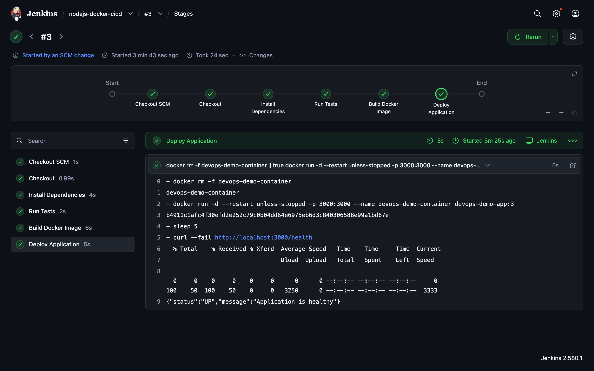
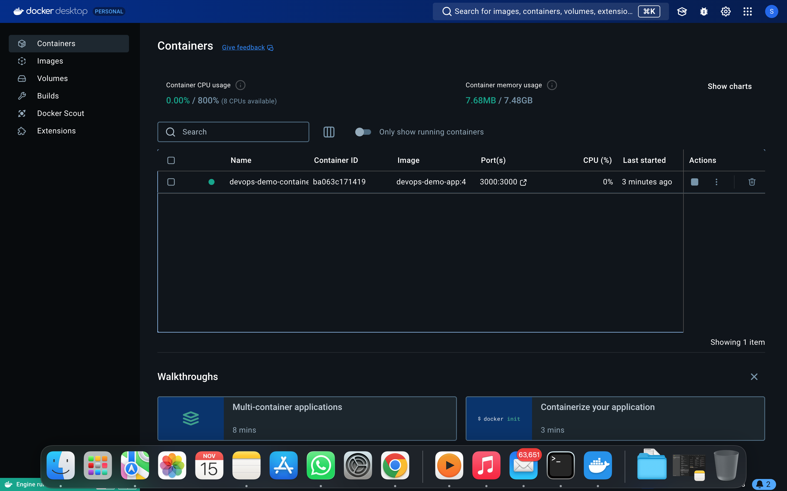
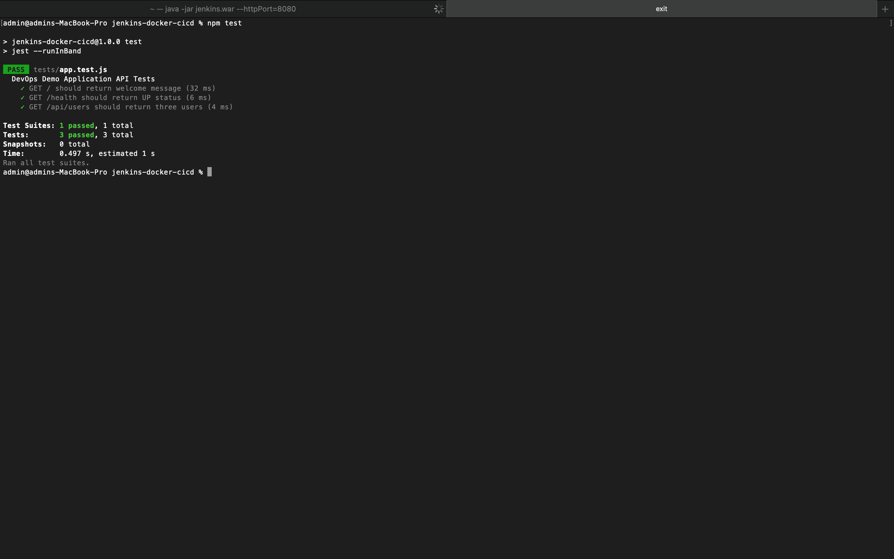

# jenkins-docker-cicd
Automated CI/CD pipeline using Jenkins, Docker, Node.js and GitHub.

# Automated CI/CD Pipeline for Node.js REST API

## Project Overview

This project demonstrates an automated CI/CD pipeline for a Node.js REST API using Jenkins, Docker, and GitHub.

Jenkins fetches application source code from GitHub, installs dependencies, executes automated tests, builds a Docker image, and deploys the application locally.

The pipeline also uses GitHub SCM polling to detect new commits and automatically trigger builds.

## Technologies Used

- Node.js
- Express.js
- Git and GitHub
- Jenkins
- Docker
- Jest
- Supertest
- Bash

## CI/CD Architecture



**Architecture Explanation:**

1. Developer pushes code to GitHub.
2. Jenkins checks GitHub periodically using SCM polling.
3. Jenkins installs dependencies and runs automated tests.
4. Docker builds a new application image.
5. Jenkins deploys the updated container locally.
6. Jenkins verifies the deployment using the health endpoint.

## Application Features

- Welcome API endpoint
- Application health-check endpoint
- Sample users API
- Automated API testing
- Docker containerization
- Jenkins CI/CD automation
- Automated deployment and health verification

## API Endpoints

| Method | Endpoint | Description |
|---|---|---|
| GET | / | Welcome message |
| GET | /health | Application health |
| GET | /api/users | Returns sample users |

## CI/CD Pipeline Stages

1. Checkout: Fetch source code from GitHub.
2. Install Dependencies: Install Node.js packages using npm ci.
3. Run Tests: Execute automated tests using Jest and Supertest.
4. Build Docker Image: Build a Docker image for the application.
5. Deploy Application: Replace the running container with the latest version.
6. Health Check: Verify deployment using the /health endpoint.

## Docker

Build the Docker image:

```bash
docker build -t devops-demo-app:1.0 .
```

Run the container:

```bash
docker run -d -p 3000:3000 --name devops-demo-container devops-demo-app:1.0
```

## Run Locally

Clone the repository:

```bash
git clone https://github.com/shivamshekhawat/jenkins-docker-cicd.git
cd jenkins-docker-cicd
```

Install dependencies:

```bash
npm ci
```

Run tests:

```bash
npm test
```

Start the application:

```bash
node app/server.js
```

Access the application:

- http://localhost:3000
- http://localhost:3000/health
- http://localhost:3000/api/users

## Jenkins Automation

The Jenkins pipeline is defined in the `Jenkinsfile` at the root of this repository.

SCM polling checks GitHub periodically for new commits and triggers a pipeline when changes are detected.

## Project Learning Outcomes

- Created a CI/CD pipeline using Jenkins.
- Integrated GitHub source control with Jenkins.
- Automated application testing.
- Containerized a Node.js application using Docker.
- Implemented automated local deployment.
- Added deployment health verification.
- Configured SCM polling for automatic build triggering.

## Project Screenshots

### 1. Jenkins Pipeline Execution


### 2. Jenkins Console Output


### 3. Docker Container Running


### 4. Automated Test Results


## Author

Shivam Shekhawat
